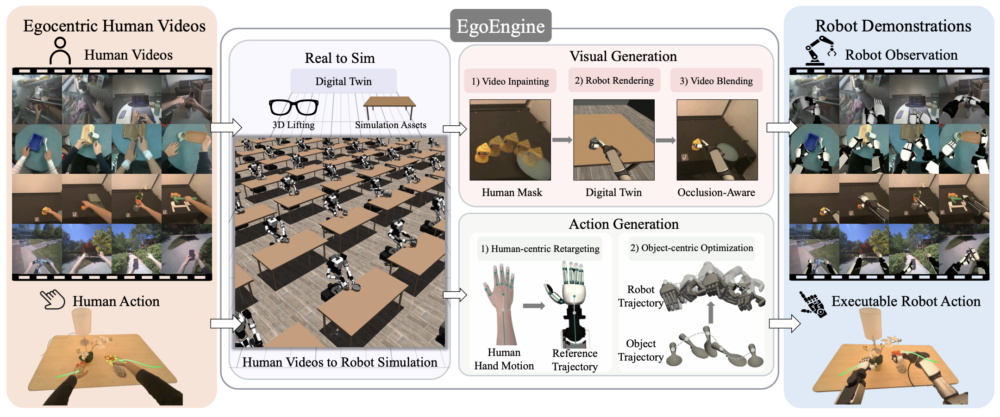
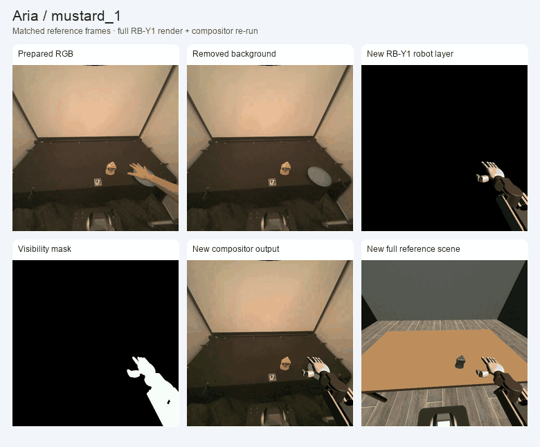

<div align="center">

# EgoEngine

### From Egocentric Human Videos to High-Fidelity Dexterous Robot Demonstrations

**CoRL 2026 · Conference on Robot Learning**

[Yangcen Liu](https://yangcenliu.github.io/),
[Shuo Cheng](https://sites.google.com/view/shuocheng),
[Xinchen Yin](https://xinchenyin.github.io/)<sup>†</sup>,
[Woo Chul Shin](https://woocshin.github.io/profile/)<sup>†</sup>,
[Alfred Cueva](https://alfred-cueva.github.io/)<sup>†</sup>, Yiran Yang,
[Zhenyang Chen](https://chenzheny.github.io/),
[Chuye Zhang](https://zhangchuye.github.io/),
[Danfei Xu](https://faculty.cc.gatech.edu/~danfei/)

<sub>† Co-third authors (equal contribution).</sub>

[](https://arxiv.org/abs/2606.12604)
[](https://github.com/GaTech-RL2/EgoEngine-CoRL2026)
[](https://egoengine.github.io/)
[](https://x.com/Randle_Liu/status/2069023588154290538?s=20)

[Use my robot](docs/USE_MY_ROBOT.md) · [Reproduction guide](docs/REPRODUCIBILITY.md)

</div>



EgoEngine converts egocentric human demonstrations into paired robot observations
and actions. This repository unifies the visual and action branches, starting
from a **preprocessed dataset**: calibrated cameras, original robot retargets,
scene assets, kinematic references and demonstrator-free background videos.
FoundationPose and early perception/reconstruction are outside this release.

- **Visual branch:** replay the original RB-Y1 joint commands, object motion and
  camera track; render the robot and visibility mask; composite the robot onto
  the prepared background using the original materials and blending settings.
- **Action branch:** refine floating-wrist XHand EEF controls using adaptive
  Replay → MPC → RL switching with two-chunk planning and one-chunk execution.
- **Dataset:** align the two outputs by case and reference frame, then export
  RGB, EEF actions, simulated states, timestamps and calibration to HDF5.

## Quick start: visual branch and dataset export

Use Python 3.10 and an OpenGL-capable machine. The visual environment requires
no Torch or CUDA installation. Run from an editable source checkout:

```bash
git clone https://github.com/GaTech-RL2/EgoEngine-CoRL2026.git
cd EgoEngine-CoRL2026
python3.10 -m venv .venv-visual
source .venv-visual/bin/activate
python -m pip install -r requirements/visual-tested.txt
python -m pip install --no-deps -e .

egoengine list
egoengine validate
egoengine demo --case mustard_1
```

On a headless Linux GPU host, set `MUJOCO_GL=egl` before rendering. The command
generates a new RB-Y1 render, composite and paired reference-EEF dataset:

```text
outputs/mustard_1/
  render/scene.mp4
  render/foreground.mp4
  render/visibility_mask.mp4
  render/rby1_commands.npz
  render/render.json
  render/original_pipeline/
  visual.mp4
  visual.json
  dataset.hdf5
```

The CPU demo exports the supplied reference EEF controls. Use the CUDA workflow
below to train refined actions. Visual generation always uses the original
retarget commands independently of action refinement.

```bash
# Validate all six inputs and generate all three Aria datasets.
bash scripts/reproduce_cpu.sh
# Rebuild the rendering examples and stage GIFs.
bash scripts/reproduce_rendering.sh
```

## Prepared examples

Three TACO interactions and three different Aria Mustard demonstrations are
included with their assets. See the [input format](docs/INPUTS.md) and
[example manifest](examples/prepared/README.md).

| Dataset | Case | Frames | Included inputs |
| --- | --- | ---: | --- |
| Aria | `mustard_1` | 93 | Complete visual and action inputs |
| Aria | `mustard_2` | 105 | Complete visual and action inputs |
| Aria | `mustard_3` | 108 | Complete visual and action inputs |
| TACO | `brush_brush_bowl_20230927_027` | 209 | Action input, robot rendering, historical visual previews |
| TACO | `cut_knife_plate_20230926_040` | 210 | Action input, historical visual previews; saved retarget gives an empty robot mask |
| TACO | `scrape_off_knife_plate_20230926_034` | 228 | Action input, robot rendering, historical visual previews |

The TACO examples lack prepared demonstrator-free backgrounds, so their final
composites cannot currently be regenerated. All three Aria examples support the
complete visual/export workflow. Prepared references retain their original
values; the released retargeting code contains no per-task trajectory corrections.

The following Aria panels show source RGB, prepared background, newly rendered
RB-Y1 foreground, visibility mask and the resulting composite:



TACO stage previews and their source/alignment labels are recorded in the
[media manifest](docs/media/manifest.json). Historical display clips are not
used as newly generated paired training data.

## Action branch: Replay → MPC → RL

Use a separate Linux Python 3.12 environment with an NVIDIA CUDA runtime:

```bash
python3.12 -m venv .venv-action
source .venv-action/bin/activate
python -m pip install -r requirements/action-tested.txt
python -m pip install -e .
egoengine doctor

egoengine action --case mustard_1
# Replay only:
egoengine action --case mustard_1 --methods replay
# Explicit compute budget:
egoengine action --case mustard_1 \
  --action-args '--mpc-num-samples 8 --mpc-max-iters 2 --rl-total-learning-iterations 1500'
```

The action simulator trains **floating-wrist EEF + XHand controls**. At each
20-control-step boundary, Replay, MPC and RL try the same saved state in order.
The first candidate that passes the full two-chunk plan commits its current
chunk. The next boundary starts from Replay again. Failed partial trajectories
are rejected by the dataset exporter.

Defaults are eight MPC samples, two MPC iterations, 1024 RL worlds and a shared
1500-iteration PPO budget. Each RL window has a 300-iteration cap and continues
the last accepted actor, critic, normalizers and optimizer. The goal-conditioned
observation and residual PPO formulation are documented in
[RL_RECIPE.md](docs/RL_RECIPE.md); the selector and original simulation-step
metric conventions are in [MODE_SWITCHING.md](docs/MODE_SWITCHING.md).

Training outcomes vary across runs and cases. The current release does not
establish successful action generation for every bundled TACO example or a
verified simulation-step reduction over full-horizon RL. See the
[validation scope and comparison commands](docs/REPRODUCIBILITY.md).

## Join the branches

Generate the visual outputs in the visual environment:

```bash
egoengine render --case mustard_1
egoengine composite --case mustard_1 --render-dir outputs/mustard_1/render
```

After `egoengine action --case mustard_1` succeeds in the CUDA environment,
export the refined actions together with those visuals:

```bash
egoengine export --case mustard_1 --video outputs/mustard_1/visual.mp4 \
  --trajectory outputs/mustard_1/action/trajectory_mjwp_mixed.npz \
  --visual-source original_retarget_render
```

Both environments share files through the same checkout and output directory.
If both dependency profiles are available in one environment, `egoengine run
--case mustard_1` executes the complete pipeline. Retained source and asset
provenance is recorded in [UPSTREAMS.json](UPSTREAMS.json).

## Use my robot

The [Franka + XHand guide](docs/USE_MY_ROBOT.md) includes a working configuration,
three rendered examples and commands for replacing the visual arm while keeping
the original XHand, camera/object tracks and compositor:

```bash
egoengine demo --case mustard_1 --robot-config examples/robots/franka_xhand.json \
  --output outputs/franka_xhand
```

## Dataset format

The HDF5 schema is `egoengine.prepared.v1`. Arrays under `data/demo_0` share the
reference-frame clock:

| Dataset | Meaning |
| --- | --- |
| `actions` | EEF actuator targets: floating wrist XYZ/angles + XHand joints |
| `obs/qpos`, `obs/qvel` | Action simulator states, including objects |
| `obs/joint_pos` | Action simulator robot positions |
| `obs/agentview_image` | Composited RGB, default 256 × 256 |
| `obs/rby1_joint_commands` | Original RB-Y1 visual joint commands |
| `obs/robot_joint_commands` | Optional configured-robot visual commands |
| `obs/camera_to_world` | Visual camera pose in the original retarget world |
| `camera_intrinsics` | Intrinsics scaled to the stored image dimensions |
| `timestamps` | Seconds on the reference clock |

The exporter validates frame counts, case identity, finite arrays and successful
action completion before writing atomically. Visual joint commands and EEF
action states have separate provenance. See [INPUTS.md](docs/INPUTS.md) to prepare
another case and select it with `egoengine --data-root /path/to/prepared ...`.

## Validation and source layout

```bash
python -m unittest discover -s tests -v
# With the optional action and retargeting test dependencies installed:
bash scripts/test_all.sh
```

See the [reproduction guide](docs/REPRODUCIBILITY.md) for environment-specific
checks, expected artifacts and known limitations.

```text
egoengine/          CLI, visual adapters, alignment and HDF5 export
spider/             Action simulator, sampling solver and residual RL
action/examples/    Replay, MPC, RL and adaptive mode-switching runners
visual/             Retained robosuite replay, retargeting and compositor
examples/prepared/  Three TACO and three Aria cases with portable assets
examples/robots/    Visual robot configurations
scripts/            Reproduction, validation and visualization commands
requirements/       Tested visual and CUDA dependency profiles
docs/               Input contracts, algorithms and example media
licenses/           Upstream licenses
```

## Citation

```bibtex
@inproceedings{liu2026egoengine,
  title     = {EgoEngine: From Egocentric Human Videos to High-Fidelity Dexterous Robot Demonstrations},
  author    = {Liu, Yangcen and Cheng, Shuo and Yin, Xinchen and Shin, Woo Chul and Cueva, Alfred and Yang, Yiran and Chen, Zhenyang and Zhang, Chuye and Xu, Danfei},
  booktitle = {Conference on Robot Learning},
  year      = {2026},
  url       = {https://arxiv.org/abs/2606.12604}
}
```

## License and acknowledgments

This repository includes SPIDER-derived action code under **CC BY-NC** and
robosuite-derived visual code under **MIT**. See [LICENSE](LICENSE),
[THIRD_PARTY_NOTICES.md](THIRD_PARTY_NOTICES.md) and [licenses/](licenses/).
The paper overview is reproduced from the official
[EgoEngine project website](https://egoengine.github.io/).
